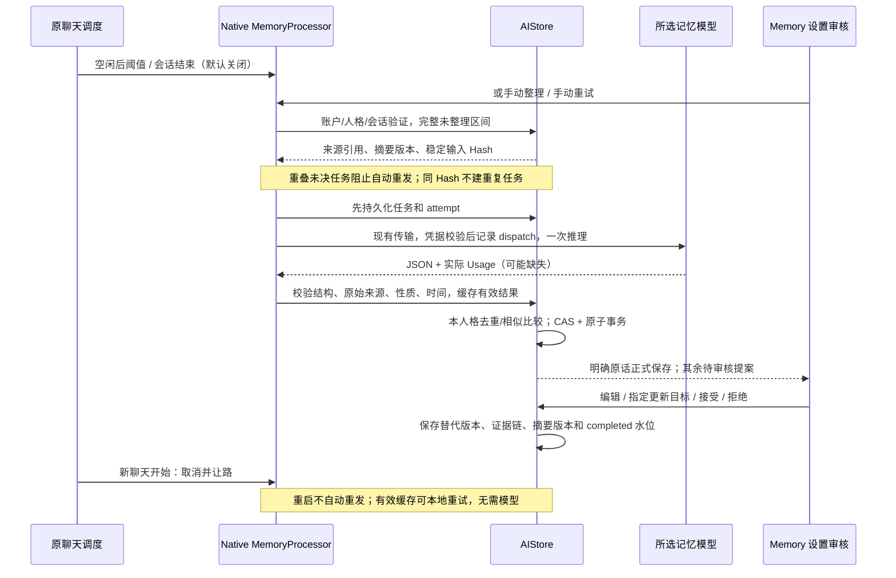

# Parlor Memory Phase C · 源码交付

本阶段与 Phase A/B 一并保留在当前工作区。未提交、推送、部署或打包，未修改真实设备数据库。Windows 没有 Swift/Xcode，原生源码及测试尚未编译执行；下面严格区分实际 SQL/浏览器验证与原生待验证项。

## 推荐架构及实施结果

继续以 Native AIStore 为唯一的本地持久化层。`AIMemoryProcessor` 是可取消、默认关闭的后台批处理器，通过 `AIRuntime.perform` 复用 API Key / ChatGPT 订阅的现有传输，使用独立设置的模型。没有增加 MCP、Supabase 表、Vercel 接口或新的推理服务。

每个人格每次只处理一个有界批次，将记忆提取、摘要和未解决事项合并为一次请求。群聊输入只包含公共消息、公共摘要及目标人格 ID/公开发言身份，**不向处理模型提供任何已有私人记忆或人格 System Prompt**。模型输出后，在本机只与目标人格的正式记忆及待审核提案比较。因此公共摘要不经过带有私人记忆的模型输入，去重及冲突判断也不会读取别人的私人记忆。

既有读取、用户手动新建/编辑正式记忆均不调用模型。自动处理只在启用后、聊天空闲且满足阈值或结束条件时执行。普通消息不会逐条启动记忆推理。

## 文件

| 新增文件 | 职责 |
| --- | --- |
| `ios/EvaOrbitHost/Sources/AIMemoryProcessing.swift` | 配置、任务、尝试记录、提案、来源/置信度元数据；结构化提取契约、稳定输入 Hash、本地相似度 |
| `ios/EvaOrbitHost/Sources/AIMemoryProcessor.swift` | 串行批次、聊天抢占、流式结果/Usage、有效结果缓存、手动重试 |
| `ios/EvaOrbitHost/Sources/AIStoreProcessing.swift` | schema v8、批次范围/幂等、来源验证、审核事务、摘要及处理水位推进、删除与失效治理 |
| `ios/EvaOrbitHost/Sources/AIProcessingBackup.swift` | v3 任务/提案/配置校验与恢复、消息 ordinal 重映射 |
| `ios/EvaOrbitHost/Tests/AIMemoryProcessingTests.swift` | 原生批次、隔离、提取、冲突/过期、摘要连续性、重试、抢占、Usage、缓存、备份测试源码 |
| `src/components/parlor-memory-processing.tsx` | Vintage Memory 内模型/自动开关、触发阈值、手动整理、审核、历史及用量 |
| `scripts/parlor-processing.test.mjs` | 在 Node SQLite 执行实际 Swift 内嵌迁移、恢复和生命周期 SQL |
| `scripts/parlor-processing-fixture.js`、`parlor-processing-browser.mjs` | UI 夹具和浏览器检查，全部使用合成结果，无真实推理 |

修改的 Native 文件：`AIStore.swift`、`AIStoreMemory.swift`、`AIStoreContext.swift`、`AIStoreBackup.swift`、`AIContext.swift`、`AIPersonaMemory.swift`、`AIRuntime.swift`、`SubscriptionPoC/SIWCRuntime.swift`。分别接入迁移/备份、可复用原子事务、直接来源读取、摘要任务元数据、过期召回过滤、调度和真正的推理 dispatch 计数边界。没有改动认证协议、权限或安装签名链。

修改的前端/夹具文件（含 `scripts/parlor-browser.mjs` 对新回复的明确等待，避免停止测试误认旧回答）：`src/lib/native-eva.ts`、`native-eva-context.tsx`、`native-eva-chat.tsx`、`parlor-memory.tsx`、`parlor-settings.tsx`、`parlor-memory.module.css`、`scripts/native-eva-fixture.js`、`parlor-memory-fixture.js`、`parlor-context-browser.mjs`。保留既有未提交文件及其成果。

## 数据与迁移

schema **v8** 只增加三张表，v5/v6/v7 沿既有兼容迁移链进入 v8，升级前仍使用 SQLite online backup。

- `ai_memory_processing_config`：账户 + 人格配置。automatic 默认 false；threshold 10–500（默认 40）；onConversationEnd 默认 false；modelMode 为 persona/dedicated。
- `ai_memory_jobs`：账户、人格、会话、固定消息引用及版本、输入 Hash、旧摘要引用、实际 Provider/Model 快照、API/订阅类别、尝试/dispatch/Usage/估算费用、输出结果和摘要应用状态。唯一键 `(account, persona, conversation, input_hash)`。
- `ai_memory_proposals`：账户/人格/会话/任务、候选正文及证据、目标记忆及期望版本、接受后的记忆 ID、原因与生命周期。

任务状态为 queued/running/completed/failed/interrupted/cancelled/stale；提案区分 pending/accepted/rejected/duplicate/invalidated/deleted。原始消息始终保留。处理水位使用最高 completed 任务的末尾消息 ID/ordinal，不用另建进度表；来源、摘要或未整理范围不一致时不盲目跨过历史。

Persona Memory 增加可选 provenance（任务、提案、Provider/Model、置信度、事件原文时间）及 expiredAt。时间只保存来源中实际出现的表达，不补未知时刻、午夜或推断日期。expiredAt 表示经审核标记过期；保留完整版本链，过期版本不参与 Phase B 召回。

Conversation Context 增加可选 processingTaskId/processingInputHash/processingProviderId/processingModelId，纳入内容 Hash；没有这些字段的旧摘要 Hash 语义保持兼容。新摘要通过已完成的轮次边界和 expectedVersion 校验。模型遗漏旧待办时不会自动丢弃；只有附带本批用户完成/取消证据的 resolved 项才尝试移除，无法识别的表达保留给 Context 手动修正。群聊在公共水位已相同或更新时保留现有摘要，避免各人格反复改写同一段公共内容。

## 配置与触发

Memory 中先选择人格，再展开“自动记忆与整理”。选择专用模型或“复用当前所选人格的聊天绑定”，保存配置后生效。

- 专用：明确选择启用的 Provider/Model；与聊天模型设置完全独立。
- 复用：处理目标会话中**这个人格**的会话 override 优先，其次该人格绑定，再其次本会话这个人格最近实际使用的模型；没有第一位群聊参与者/第一个 Provider 的回退。绑定不可用时拒绝处理，不发起推理。
- 阈值：聊天停止生成后，未整理的持久化消息数达到设置值才启动；COUNT 查询与 201 条读取保护分开，500 阈值也能触发。
- 结束：离开/切换聊天、页面离开，以及 Discussion 正常或显式结束；需要 automatic + onConversationEnd 同时启用。不是每一轮普通讨论的终止信号。
- 手动：自动开关关闭时仍可整理；每次一个批次，最多 120 条，按模型预算减少，末尾停在已完成的逻辑轮次边界。不自动循环清空长档案。

批次读取有 2 MiB 保护，达到读取保护时剔除末尾未读完的单元，并在发送前验证批次末尾边界，避免付费后才发现无法推进摘要水位。输入使用 Phase B 估算及窗口安全预留；输出受估算预算及 64 KiB 限制。无法容纳必要输入时拒绝付费调用，聊天不受影响。

## 流程

## 记忆治理

本地标准化文本识别精确重复；字符二元组相似度提供合并目标建议；模型的 change 字段区分 new/supplement/replace/conflict/expire。提案显示来源、认知性质、置信度，用户可看旧记忆并编辑内容；未匹配的变更必须先选择要更新的正式记忆。

自动正式保存严格限于：new、置信度至少 0.95、userStatement、全部引用用户消息、正文确实存在于原话、无现有相似目标及重复待审提案。其他观察、低置信度、补充、替代、矛盾和过期判断均待审核。相似度及模型 change 不保证语义矛盾完全可识别，不能把这一机制当作完整事实推理器。

接受变更时验证目标版本，保留原证据与新证据（有界 20 项），创建替代版本；不覆盖旧正文。拒绝不改变正式记忆。重复不产生另一条正式记忆。新提取记忆默认仅单聊，用户可在原记忆编辑器中控制群聊可见性。

来源修改、重生成替代或删除使相关任务 stale、待审提案 invalidated。删除正式记忆清理相关提案正文与任务结果，并撤回该人格未完成任务的缓存，防止后台结果重新保存已忘记的内容，保留请求/Usage 审计；会话删除一并清理本会话任务、提案和既有衍生记忆。聊天记录中的既有内容仍是原始记录，删除独立记忆不会改写聊天正文。App 外部备份不自动删除。

## 请求次数与 Usage

| 操作 | 新增推理 |
| --- | --- |
| 未触发批次的普通聊天、记忆读取、手动保存明确正文、审核提案 | 0 |
| 单聊一个批次 | 1 |
| Parallel 一个批次，K 个已启用/明确选择的处理人格 | K（各自一次，不额外单开摘要请求） |
| Discussion 停止/结束后的一个批次 | K，不按每条发言或每个普通轮次调用 |
| 失败/中断后的付费重试 | 仅用户点击后，原任务新增 attempt，最多再一次请求 |
| 有效结果已缓存，仅本地写入失败/中断 | 本地应用缓存，0 |

dispatch 在凭据与端点验证后、现有 HTTP/SIWC 推理发送边界之前持久化；模型目录读取、订阅 OAuth 刷新属于普通网络请求，不计作推理。网络发送前后的崩溃存在不可判定窗口，因此 dispatched 表示已进入发送边界，不能证明服务器确实受理/扣费。没有响应的尝试保留实际已知的 Usage，其余显示未知，不把未知当零。没有获取账单的接口，不声称记录了供应商实际扣款。

每个 attempt 分开保存 Usage。API 仅在实际 Token 与现有价格快照完整时估算费用；订阅货币费用为未知。失败不会自动重试。重启将 queued/running 标记 interrupted，且任何未决范围都会阻止新的自动重叠批次；出现新消息也不会借此自动重发未知结果的旧请求。

本轮**实际真实模型推理请求为 0**，没有读取或使用真实 Provider 凭据。最终一次完整浏览器回归中，每个视口夹具产生 1 条合成 dispatch、95 输入/67 输出合成 Token；手机和桌面合计 2 条、190/134，全部是固定测试数据，不是供应商返回的用量或账单。原生注入传输测试预期的次数另在测试源码断言，本机未执行，不能当作实际测试统计。

## 模式示例

以下为源码策略和原生测试输入的构造示例，非真机抓包：

- 单聊 Sebastian：10 条已完成消息 → 1 个任务；`userStatement` 原话“我更喜欢安静的步道”可直接保存，推断“用户可能不喜欢人群”进入待审核；同一结果更新摘要和“确认出发日期”。再次整理没有新范围时不发请求。
- Parallel Sebastian + Ada：两人都启用时，各自按模型预算和处理水位选择公共消息，各处理 1 次，得到不同任务、不同记忆 ID 和各自提案。任何已有私人记忆均不发送；本地比较分别绑定其人格。公共摘要只由成功推进水位的批次更新，同一覆盖范围不反复替代。
- Discussion：若最终公共历史包括三轮发言、插话和取消的部分回答，处理使用已持久化状态及有效替代回答；每个启用人格处理一个批次。不会在每轮结束都发提取请求。未处理档案超过单批上限时留待下一次触发或手动处理。

## 备份与恢复

独立导出升级 **version 3 / schema 8**，继续导入 v1/schema6 与 v2/schema7。包含配置、任务/尝试/Usage、提案、正式记忆和摘要来源关系；保持 16 MiB 整份文件限制和一致性安全备份。恢复前验证账户、校验和、版本、来源、任务/提案/模型关系；按稳定消息 ID 重映射任务 ordinal。恢复后自动处理一律关闭，Provider 仍停用，未完成任务中断，不启动推理。凭据仍不导出。

## 验证

- 完整 Node：**878 项，863 通过、15 跳过、0 失败**。日志 `tmp/parlor-processing/full-tests.log`。
- A/B/C 专项：**18/18 通过**，其中 C 新增 6 项直接执行实际迁移、幂等、恢复、来源失效、删除治理和阈值 SQL，另检查传输 dispatch 接入和抢占位置。
- TypeScript、相关 ESLint、Impeccable 检查、Vite 客户端构建通过；构建保留既有大 bundle 提示，输出不是 IPA。
- 新 Memory 浏览器：手机 402×874 / 桌面 1280×900，默认关闭、独立模型、阈值/结束开关、提案编辑/接受、正式列表刷新、Usage 展示、v3 恢复和旧 Host 降级通过。截图 `tmp/parlor-processing/mobile-processing.png`、`desktop-processing.png`，为实际 React 夹具界面。此前发现的夹具消息条数断言、提案编辑器 accessible label 以及单聊停止测试误认旧回复的等待条件已修正。原有单聊、Parallel、Discussion、模型切换、Memory CRUD 和 Context 分页回归在两个视口均通过。
- 原生测试源码覆盖所要求的 15 类情形：自动/手动/阈值/结束与关闭；单聊/多人格/Parallel/Discussion 隔离；重复、冲突、过期及版本；摘要衔接；中断/恢复、Provider 失败/显式重试、Usage；缓存本地重试、删除及 v3 备份。
- **未执行 Swift/Xcode 编译、原生测试、真实 API/订阅推理、iPhone 16 Pro、系统后台/退出行为、原生分享/文件恢复验证。** 当前自动执行能力依赖 App/Native Host 存活；未增加 iOS 后台执行 entitlement，不保证系统挂起后继续整理。

本轮预览 PID 13200 已退出，4187 返回 ECONNREFUSED；进程核验未发现本轮预览、浏览器回归或 Next 测试服务残留。`git diff --check` 通过，只有本机 CRLF 转换提示。

## 剩余限制及下一步

本地去重/相似建议是启发式，可能漏掉语义相近或矛盾；模型结果也可能因格式、来源或预算验证而失败，这些任务需要用户处理。没有语义向量索引、跨设备同步或远端记忆数据库。大历史每次只处理一批，旧任务和版本不自动清空；大备份达到既有限制时明确失败。

没有接入 Echo、共享记忆写入或任何 Phase D 接口。Phase D 应复用现有“正式记忆/提案/来源/审核”边界，不能直接将私人任务输出同步到共享记忆。当前源码先暂停，等待下一阶段安排。
