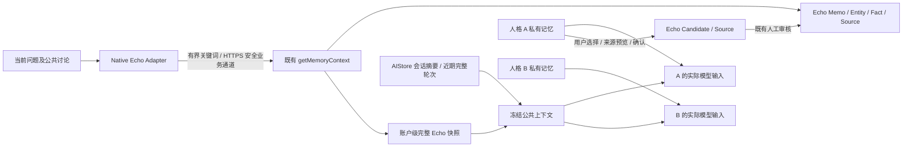
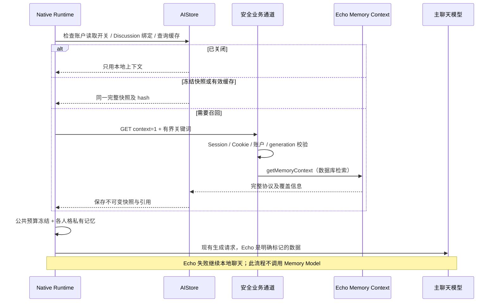
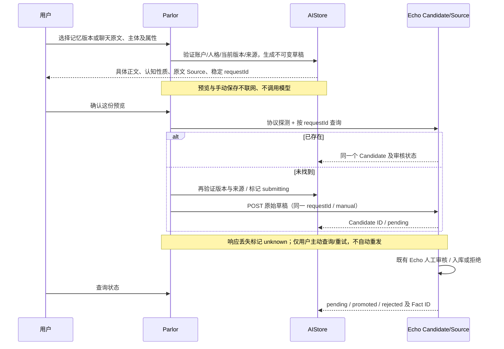

# Parlor Memory Phase D · Echo Shared Memory

Phase A/B/C/D 保留在同一工作区。本阶段交付源码候选，不进行正式验收、IPA 打包、提交、推送或部署；真实账户数据库未迁移。Windows 已验证 TypeScript、SQL、隔离 HTTP 和浏览器界面，尚未编译 Swift、执行原生测试或连接真实 Echo/Provider。

## 推荐架构与边界

Parlor 继续以 Native AIStore 为人格私有记忆、会话上下文和自动整理任务的唯一持久层。Echo 是可选的账户级共享知识来源；Native 适配器经现有 `business.request` 的实现读取完整 Memory Context，或提交用户确认过的 Candidate。读取、写入分别授权，均默认关闭。

没有新增 MCP 调用、推理接口、向量系统或 Supabase 表。Echo 的检索、Source、Candidate、审核、版本及纠错仍由原服务负责。关闭读取仅撤回召回权限；若另行开启分享，用户主动的实体查询、提交和状态查询仍可联网。两个开关均关闭时不再发起任何 Echo 请求。



## API 接入及实际前提

复用 `/api/memory-graph`，新增分支，旧 `?q=...&recall=1` 结果保持兼容。原兼容召回会简化信息，本阶段读取分支直接调用 `getMemoryContext`，不经过 `adaptMemoryRecall`。

| 请求 | 行为 |
| --- | --- |
| GET `?resource=parlor_protocol` | 返回 `parlor-echo/1`、完整上下文、Candidate 查询及人工审核能力标记 |
| GET `?context=1&q=...&limit=4&max_chars=4000` | `{protocol, context}`；保留完整 Context 协议，包括部分结果、失败/超时覆盖信息 |
| GET `?resource=entity&status=active&limit=20&q=...` | 复用现有实体分页；用户主动查找共享事实的主体 |
| GET `?resource=candidate&request_id=<UUID>` | 当前账户内按稳定 requestId 查询；不存在时 `candidate:null` |
| POST 根路由 | `{protocol:"parlor-echo/1",submission:{requestId,reviewMode:"manual",fact,sources,...}}`，返回 Candidate |

完整 Context 保留 `version/time/query/current_facts/historical_facts/unknown_facts/memos/entities/sources/notices/coverage/context_text`；Fact record、有效期、冲突/覆盖状态和 Source 完整性均保留。未知字段也保留。只有能够逐字段证明 `context_text` 是同一组权威字段的重复 JSON 时，才在模型输入中去掉这个重复串；缓存仍保存完整原始协议。没有用简化召回替代完整协议。

服务端关键词长度 1–160，limit≤8、max_chars≤12000；Native 使用最多 8 个词/中文二三字词及 max_chars=4000，不传整段聊天或私人记忆。服务端字符预算属于检索预算，完整外层包仍包含覆盖等元数据；Native 另设 128 KiB 协议上限。模型预算不够时整体省略 Echo 包，保留当前问题和近期上下文，记录 `echo_budget_omitted`，不截掉证据或覆盖字段来假装完整。

实际使用需要：新 Host/前端能力、新服务端分支、有效同账户 Session，以及现有 `onlineBusinessProtocol=1` 与账户允许开关。现有治理迁移 `202611070002_memory_write_governance.sql` 提供 `(user_id,request_id)` 幂等与审核 RPC；本阶段不增加远端迁移，也未执行生产迁移。Supabase 查询仍经过既有认证 Repository/RLS。

旧 Host 不公布这七个可选能力时，界面保留本地记忆并提示更新；旧服务端缺少完整协议时读取降级。分享先探测协议；POST 使用嵌套 submission，旧服务端无法把它误认成旧版直接事实写入。协议未知或旧服务器均不降级为不受控写入。

## Native 安全调用

`NativeBridge → AIRuntime → AIEchoClient → TrackerLocalController.businessRequest → 原业务 API`。没有新增任意 URL 或直接获取凭据的能力。

业务白名单仅新增根路径 `/api/memory-graph` 的 GET/POST，不开放 Candidate PATCH/DELETE 或 MCP。保留本地主 frame/origin/bridge 版本、账户绑定、Session 同账户、账户开关、generation、同源 HTTPS、冻结 Cookie、拒绝重定向、请求/响应 8 MiB 限制。Echo 使用 ephemeral session、请求超时 5 秒、资源超时 8 秒；之前的业务请求超时不变。Echo 不进入通用 onlineCache 或离线写队列，不自动重试。登录切换和中断会取消适配器任务并拒绝旧响应。

设置变更在生成准备/聊天/讨论控制期间被拒绝，界面明确禁用，避免同轮权限变化破坏冻结输入。适配器额外按读取和写入分别维护取消世代；撤回分享权限不复活未知写入，也不会在权限变化后保存已撤回的召回正文。

## 读取与三种聊天模式



单聊每次实际新生成至多召回一次；缓存命中不联网。Parallel 先一次召回，再为所有参与者冻结同一个公共包；最小参与窗口约束公共上下文，每人独立选择自己的私有记忆和输出预算。不会按人格重复召回。

Discussion 按 discussion ID 冻结整场共享快照，包括失败状态；后续轮次无需重复访问 Echo，公共历史仍继承已完成讨论。即使 TTL 已过，也沿用这份标明 fetchedAt 的讨论快照。用户插话带“换个话题/新话题/另一个问题/change topic/new topic”，且关键词变化时刷新；否则仅在旧新集合均至少 4 词且交并比 <0.1 时认定明显换题。这个规则是本地确定性估算，不调用模型。正文被清理/淘汰时降级，不悄悄联网替换原快照。

重生成依据原 publicContextId、Echo ID/hash 及本人记忆版本回放，不再次召回。原正文已撤回时生成新的降级快照并记录 `frozen_context_degraded`。群聊持久轮次已有 B 的引用机制：有 publicContextId 就不重复保存 context 正文，因此关闭缓存不会从旧 round.context 复活 Echo 数据。

以下是与源码/新增 Swift 测试一致的输入结构示例，**尚非真机抓取**。真实服务端完整协议已由隔离 HTTP 测试验证；Swift 模型输入实例需在 macOS 执行测试后核验。省略号仅用于本文展示，实际实现传递完整包或整体省略。

```text
单聊 Sebastian
 system: Sebastian.runtimePrompt
 user data persona_memory: 仅 Sebastian 相关 active 版本及来源
 user data echo_shared_memory: snapshot=E1, fetchedAt=T, status=partial
   {version:1, current_facts:[...], historical_facts:[...], unknown_facts:[...],
    memos:[...], entities:[...], sources:[...], notices:[...], coverage:{...}, ...}
 user data conversation_summary / unresolved: 本会话有效摘要及水位
 recent user/assistant: 最近完整轮次
 user: 当前问题

Parallel
 Public P1 = 同一个 E1 + 群聊摘要/待办 + 同一历史快照 + 当前问题
 Sebastian 输入 = 自己的设定 + 自己的相关私人数据 + P1
 Ada 输入       = 自己的设定 + 自己的相关私人数据 + P1
 P1 不含任何 Persona Memory；先完成的输出不进入同轮 P1

Discussion
 D1/R1: 公共 E1 + R1 前公共历史，所有参与者一致
 D1/R2: 同一个 E1 + R1 已完成/部分/失败标记 + R2 指令
 用户明显换题后 R3: 刷新一次为 E2 + 已完成历史 + 最新用户指引
 重生成 R1: 使用原 R1 引用；不加入被替代回答或随后轮次
```

## 受控分享、来源与重试

用户在记忆详情或 Echo 设置中选择已保存的聊天片段，查找既有 Echo 实体并选择事实主体，可调整 predicate 和原文片段。本阶段不自动创建 Entity，也不自动做事实拆解；每次提交是用户选定的一个事实及其 Source。手动记忆没有有效原始消息证据时拒绝分享，提示检查来源。



草稿保留记忆 ID/version/hash、来源消息 ID/seq/hash、原文与原始会话关联；Source 的 `sourceRecordId=parlor:<conversationId>:<messageId>`，note 保留分享人格、原发言人格、创建时间、源 hash 和认知性质，不伪造 HTTP 来源地址或事件时间。正文和原文不可被确认后的重试悄悄修改。

只有 userStatement 且所有证据为用户消息、选定正文确实出现在原话中，才标记 direct_statement/proposedBy=user。人格观察为 agent_judgment，其他非直接事实为 derived；同意分享不提高置信度。**所有 Parlor 分享均使用 manual**，即使直接原话也不使用 user_confirmed、不自动入库。

服务端幂等保证同 ID 同 payload 返回同一 Candidate，不同 payload 冲突；Native 每次重试先查询，重启后的 submitting 转 unknown，不自动发送。已拒绝/已入库的 Candidate 仍返回原 ID，不新建。后续修正沿用 Echo 自身审核与版本流程。

删除本地记忆、删除/替换/更改来源会清理分享的本地正文、冻结 payload 及来源引用，保留 requestId/Candidate ID 审计元数据；迟到响应不能恢复已清理正文。删除本地会话还处理其他会话来源的关联分享。本地操作不删除远端 Echo；Echo 删除仍由 Echo 治理入口处理。

## 持久化、缓存与备份

AIStore schema **v8→v9**，在原迁移序列末尾执行增量事务，旧库先做一致性 SQLite 安全备份。新增四张本地表：

| 表 | 范围与内容 |
| --- | --- |
| ai_echo_config | account_id 主键；独立读/写开关、最近状态、API 尝试计数 |
| ai_echo_snapshots | (account_id,id)；关键词、完整协议、hash、时间/TTL、覆盖状态 |
| ai_echo_bindings | (account_id,discussion ID)；冻结快照绑定 |
| ai_echo_shares | (account_id,requestId)；persona/conversation、不可变草稿、来源版本、提交/审核回执 |

三个 payload 表有归属 CHECK；读取分享还绑定 persona。仅缓存小范围召回结果，最多 32 份正文/账户、单份≤128 KiB，TTL 10 分钟，不镜像 Echo。元数据继续保留供生成引用审计。关闭读取清理当前账户缓存正文/绑定，使相关公共及私人生成回执失效；本地记忆和自动整理不变。离线可继续用有效缓存/讨论冻结快照；网络失败即使用本地上下文。不会自动上传等待网络。

备份升级 **v4/schema9**，继续接受 v1/schema6、v2/schema7、v3/schema8。导出分享草稿与回执和快照元数据，**不导出 Echo 召回正文或 Discussion 缓存绑定**，不含凭据。恢复校验账户、人格、原文、消息序列/hash、版本和关联，重映射 ordinal；读取和写入均关闭，submitting→unknown，不自动联网。物理 SQLite 安全备份仍属于受文件保护的内部副本，不能当作新账户缓存使用。已经生成的聊天正文不会因为关闭 Echo 被改写。

## 请求次数、Usage 与成本

| 场景 | Echo API 逻辑尝试 | 新增记忆模型推理 |
| --- | --- | --- |
| 默认关闭 / 本地查看、保存、分享预览 | 0 | 0 |
| 单聊或 Parallel 无缓存召回 | 1（不乘人格数量） | 0 |
| 有效缓存 / Discussion 后续同主题轮次 / 重生成 | 0 | 0 |
| 实体查询每页 | 2：协议探测 + 查询 | 0 |
| 首次确认分享 | 3：协议探测 + requestId 查询 + POST | 0 |
| 状态查询 / 已存在回执的安全重试 | 2 | 0 |

API 尝试次数记录实际进入适配器的尝试，包括 Session 失败；不等于服务端成功次数。现有安全通道通常每次业务尝试还有一次 Session HTTP 校验，不能把 1 次 Echo API 标成只有 1 个网络包。正常主聊天请求数沿用原调度，Echo 不新增推理。

Echo 包加入原模型的输入预算和 Usage：有 Provider 实际 Usage 时沿用 Provider 总数；不可得时保留包含 Echo 的整份输入估算，并单列 echoTokens。API Key 费用仅按已配置真实价格计算，订阅 Provider 不虚构价格或额度；Echo HTTP/数据库费用未知，不视为模型 Token 消耗。

本轮真实 Echo 请求 **0**、真实主聊天/记忆推理 **0**，因此无真实 Token 或金额可报告。最终 D 页面测试每个视口 9 次**模拟** API 尝试，两视口共 18 次，模拟/真实模型请求均 0；隔离 HTTP 测试不访问真实账户。A/B/C 回归中的 C 夹具每视口 1 次模拟处理、95/67 输入/输出 Token，仅用于验证显示和持久化，不能视为实际账单。

## 文件与验证

新增：

- Native `Sources/AIEcho.swift`、`AIEchoClient.swift`、`AIStoreEcho.swift`、`AIEchoBackup.swift`；`Tests/AIEchoTests.swift`（11 个原生测试）。
- UI `src/components/parlor-echo.tsx`。
- `scripts/parlor-echo.test.mjs`、`parlor-echo-fixture.js`、`parlor-echo-browser.mjs` 和本文。

修改：

- Native `AIStore.swift`、`AIStoreBackup.swift`、`AIContext.swift`、`AIStoreContext.swift`、`AIRuntime.swift`、`NativeBridge.swift`、`TrackerLocalController.swift`、`ParlorPersona.swift`；C 测试的当前备份版本断言。
- `src/app/api/memory-graph/route.ts`、`src/lib/repositories/types.ts`、`supabase.ts`、`src/lib/db.ts`、`business-routes.json`。
- `src/lib/native-eva.ts`、`native-eva-context.tsx`、`native-eva-chat.tsx`、`parlor-memory.tsx`。
- 隔离 HTTP 测试、既有 Native/Memory 页面夹具、B/C 浏览器备份版本断言；开发索引与 Native 维护文档。A/B/C 及之前无关工作均保留。

执行结果：

- 完整 Node 回归：**885 项，870 通过，15 跳过，0 失败**。日志 `tmp/parlor-echo/full-tests.log`；需要生产/特定配置的既有跳过项没有当作通过。
- A/B/C/D 定向 SQL/Node：25/25。D 7 项直接执行 Native 内实际迁移/清理 SQL，覆盖幂等迁移、账户人格隔离、来源变更、迟到响应不复活、关闭读取及白名单约束。
- 隔离 Next HTTP：完整 Context、覆盖/截断、关键词上限、人工 Candidate、原始 Source、同 ID 重复、不同 payload 冲突、响应丢失后的 requestId 查询、禁止 user_confirmed；完整套件中通过。
- TypeScript、相关 ESLint、Tracker/Vite 构建通过。构建保留现有大 chunk 和 appearance 混合导入提示，没有增加依赖。Impeccable 检测通过。
- D 移动 402×874 与桌面 1280×900：读取/分享默认关闭；记忆和聊天预览；推断与原话区分；确认、回执、查询、账户/人格隔离；v4 备份；部分/截断缓存状态；关闭清理；无横向溢出、页面异常或外部请求；旧 Host 保留本地界面。
- A/B/C 页面、原单聊、模型切换回归通过；Parallel 与 Discussion 两种尺寸均通过，覆盖冻结输入、独立停止/重生成、失败隔离、插话、轮次和总结。Parallel 首轮并发回归在桌面等待模拟失败消息超时，脱离构建并发后单独完整复跑通过；未改动产品来掩盖此测试时序波动。
- 新增 Swift 测试覆盖完整协议、缓存/账户/关闭、Discussion TTL 冻结与换题、超时冻结、Parallel 私人隔离、稳定草稿与认知标签、恢复/篡改草稿不能冒充用户原话、响应丢失查询恢复、备份、旧服务端写入拒绝、预算整体降级。**Windows 未编译/执行，不记为通过。**

页面截图来自真实 React 页面及模拟 Native 数据，非 iOS 真机：

- `tmp/parlor-echo/mobile-share-preview.png`、`mobile-share-submitted.png`、`mobile-echo-settings.png`、`mobile-recall-status.png`。
- `tmp/parlor-echo/desktop-share-preview.png`、`desktop-share-submitted.png`、`desktop-echo-settings.png`、`desktop-recall-status.png`。

## 待整体审查核验

1. 在既有 macOS/Xcode 流程编译 Host，执行 A/B/C/D Swift 测试；在 iPhone 16 Pro 检查安全区、键盘、Session、取消、账户切换、真实 SQLite 备份恢复。当前无法声称已通过原生验收。
2. 后续统一发布时验证新服务端协议与既有 Supabase 治理 RPC/RLS，实测正式 Session 的完整召回、断网、Candidate 审核/入库和响应丢失；本轮未部署、未访问真实账户。
3. 用实际 Provider Usage 核对包含 Echo 的输入 Token 与订阅/API Key 统计。本文结构示例和模拟 Token 不是实际模型输入抓包或账单。
4. 确定性关键词/换题规则保守，不能保证所有自然语言主题切换；公共预算较小时完整 Echo 包会整体省略。这些情况明确记录覆盖和降级，不阻塞本地聊天。

最小后续路径：审查当前未提交差异 → macOS 原生编译/测试 → 统一安排服务端/Host 发布 → 真机整体验收；不需要建立新的共享数据库或推理服务。本阶段到此暂停。
## A–D 发布前 macOS 验证

发布阻塞修复沿用 SQLite v9 和备份 v4。Echo 按账户和用途撤销操作凭证，状态更新直接更新对应字段。清缓存保留用户权限，移除召回正文和讨论绑定，并使相关生成回执失效。上下文组装从当前账户的存储快照读取正文。自动记忆在首次等待数据库前登记同一任务，由该任务完成准备、执行和结算。在线业务请求在收到响应头以及读取正文时检查 8 MiB 上限，账户切换取消进行中的请求。

macOS 的测试入口是 `EvaOrbitHost` scheme 下的 `EvaOrbitHostTests` target。在隔离 checkout 根目录构建本地 React 资源并生成项目后，指定 Runner 上已安装的 iOS Simulator UDID 执行全套测试。

```bash
npm ci
npm run build:trackers
bash scripts/ios/prepare-assets.sh
(cd ios/EvaOrbitHost && xcodegen generate)
xcrun simctl list devices available
xcodebuild test \
  -project ios/EvaOrbitHost/EvaOrbitHost.xcodeproj \
  -scheme EvaOrbitHost \
  -destination "platform=iOS Simulator,id=${SIMULATOR_UDID:?Select an installed iOS Simulator}" \
  -resultBundlePath "${RUNNER_TEMP:?}/EvaOrbitHostTests.xcresult" \
  CODE_SIGNING_ALLOWED=NO EVAORBIT_LOCAL_TRACKERS=YES
```

重点检查 `AIEchoTests`、`AIMemoryProcessingTests`、`OnlineBusinessTests`，同时运行全部测试以覆盖 `AIContextTests`、`AIPersonaMemoryTests`、`AIRuntimeTests` 和其他原生模块。测试使用独立数据库、合成 Cookie 和 URLProtocol。真实 HTTPS、Provider、Echo 和 iPhone 前后台验收留待设备及独立测试账户。

手动运行 `iOS Native Host` 时可选择 `run_native_tests=true`，默认关闭。启用后在同一次运行中执行完整 Simulator 测试，单独保存 `.xcresult` 与日志，通过后才继续正式设备编译、签名和 IPA 上传。发布前从已获授权的私有测试 ref 检出锁定的 SHA。若暂不提交或推送，可将同一完整源码快照交给受控 Mac。快照需包含未跟踪的 A–D 源文件，排除凭据、本地数据库、`tmp` 和生成产物，并记录基线 SHA 和快照校验值。
